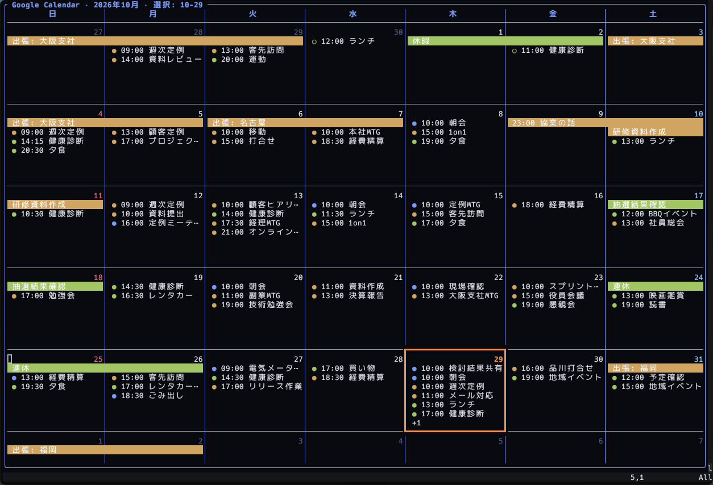

# google-calendar.nvim

A Neovim plugin that brings Google Calendar into your editor. It renders a month view, a day agenda, and an event detail card in floating windows, and lets you create, update, delete, and manage Google Meet links without leaving Neovim.

Calendar operations are delegated to [`gws`](https://github.com/googleworkspace/cli); the plugin does not call the Google Calendar API directly.



Month view in WezTerm. The weekday header stays fixed while the grid scrolls; all-day and multi-day events use colored bars, and each calendar gets its own color.

## Features

- Month view with previous/next month navigation, today jump, a highlighted selected day, and Google Calendar-style event bars and dots
- Day agenda with colored dots, start times, and event titles
- Events from multiple configured calendars, merged into one month view with automatically assigned calendar colors
- Google Calendar-style event detail card with attendees, organizer, description, and Meet URL
- Create, update, and delete events
- Multi-window event composer modeled after Google Calendar's create dialog, including recurring events
- Guest invitations by email address
- Add a Google Meet URL when creating an event, and copy it from the detail view
- Online meeting slot finder: pick weeks, a time range, and a meeting length, list the free slots that keep 1 hour around busy events, check the neighboring events on a day timeline, select slots with `<Space>` or `a`, and copy the selected slots with `y`
- In-memory month cache for fast month navigation
- Configurable window sizes, keymaps, and highlight groups

## Requirements

- Neovim 0.10 or later
- `gws` 0.22.5 or later, installed and authenticated
- A Google account with the Google Calendar API enabled

```bash
gws auth login
```

If `gws` is missing or authentication fails, the plugin reports an error and does not open the calendar.

## Installation

### lazy.nvim

```lua
{
  'skanehira/google-calendar.nvim',
  config = function()
    require('google-calendar').setup()
  end,
}
```

### Manual installation

```lua
vim.opt.runtimepath:append('/path/to/google-calendar.nvim')
require('google-calendar').setup()
```

`setup()` is optional. The plugin works with its defaults if you do not call it.

## Commands

| Command | Description |
| --- | --- |
| `:GoogleCalendar` | Open the current month. If the windows are hidden with `q`, show them again as they were. If the month view is already open, focus it and reuse the cache. |
| `:GoogleCalendar 2026-11` | Open the specified month. Hidden windows are closed first. |
| `:GoogleCalendar 2026-13` | Report an invalid month and do not open the month view. |
| `:GoogleCalendar slots` | Open the online meeting slot finder. Hidden windows are closed first. |

Use `r` or `R` in the month view to refetch the displayed month.

### Hide and show

`q` hides every plugin window at once and returns to the window you were in before opening the plugin. Nothing is closed: the screen you were on, unsaved form input, and a save or delete in progress are kept. Run `:GoogleCalendar` to show the windows again. `:GoogleCalendar 2026-11` or `:GoogleCalendar slots` closes the hidden windows instead; a save or delete still in progress then finishes in Google Calendar without a notification. To hide and show with one key, map `toggle()`:

```lua
vim.keymap.set('n', '<leader>gc', function()
  require('google-calendar').toggle()
end)
```

`toggle()` shows the hidden windows, hides the windows that are shown, and opens the current month when nothing is open. `<Esc>` closes only the current window and returns to the previous one.

## Default keymaps

| Screen | Key | Action |
| --- | --- | --- |
| Month | `h` / `l` | Select the previous / next day |
| Month | `k` / `j` | Select the previous / next week |
| Month | `H` / `L` | Go to the previous / next month |
| Month | `t` | Jump to today |
| Month | `<CR>` | Open the day agenda for the selected day |
| Month | `a` | Create an event on the selected day |
| Month | `s` | Open the online meeting slot finder |
| Month | `r` / `R` | Refetch the displayed month |
| Month | `?` | Open help |
| Month | `<Esc>` | Close the month view |
| Agenda | `j` / `k` | Select an event |
| Agenda | `<CR>` | Open the selected event |
| Agenda | `<C-o>` | Open the selected event in Google Calendar |
| Agenda | `d` | Delete the selected event |
| Agenda | `?` | Open help |
| Agenda | `<Esc>` | Return to the month view |
| Detail | `e` | Open the update form |
| Detail | `d` | Open the delete confirmation |
| Detail | `y` | Copy the Meet URL |
| Detail | `g` | Expand or collapse the guest list |
| Detail | `?` | Open help |
| Detail | `<Esc>` | Return to the agenda |
| Confirm | `y` | Delete the event |
| Confirm | `n` / `<Esc>` | Close the confirmation without deleting |
| Form | `<Tab>` / `<S-Tab>` | Move to the next / previous composer row |
| Form | `<CR>` | Open the editor for the selected row, or toggle Meet |
| Form | `<Space>` | Toggle all-day or Meet |
| Form | `:w` | Save |
| Form | `<Esc>` | Cancel. In insert mode, `<Esc>` leaves insert mode first. |
| Form | `?` | Open help |
| Form editor | `<CR>` | Edit the selected date/time field |
| Form editor | `:w` | Apply the editor value and close it |
| Form editor | `<Esc>` | Close the editor without applying |
| Slot filter | `j` / `k` | Move between choices (headings are skipped) |
| Slot filter | `<Space>` | Choose a time range or length, or toggle a week |
| Slot filter | `<CR>` | Search slots with the chosen conditions |
| Slot filter | `?` | Open help |
| Slot filter | `<Esc>` | Close the slot filter |
| Slots | `j` / `k` | Select a slot and redraw the timeline |
| Slots | `<Space>` | Toggle selection of the current slot |
| Slots | `a` | Select all slots; press again to clear the selection |
| Slots | `y` | Copy selected slots |
| Slots | `?` | Open help |
| Slots | `<Esc>` | Return to the slot filter |
| Help | `<Esc>` | Close help |
| Every screen | `q` | Hide every plugin window (normal mode only). See [Hide and show](#hide-and-show). |

All keys can be changed through `setup()`. See `:help google-calendar-keymaps` for details.

## Configuration

```lua
require('google-calendar').setup({
  -- Additional calendars. primary is always displayed and included first;
  -- omit it here. Prefer the config file below to keep IDs out of dotfiles.
  calendars = { 'work@example.com' },

  -- First day of the week: 'sunday' or 'monday'.
  week_start = 'sunday',

  -- Maximum number of events shown in a month cell (1-10, default 6).
  max_events_per_cell = 6,

  -- Month view size as a ratio of the usable area (excluding the border).
  -- 1.0 fills the available space.
  width = 1.0,
  height = 0.7,

  -- Agenda and detail sizes as ratios of the usable area.
  agenda = { width = 0.5, height = 0.7 },
  detail = { width = 0.5, height = 0.5 },

  -- Date format.
  date_format = '%Y-%m-%d %H:%M',

  -- Path or name of the gws executable.
  gws_cmd = 'gws',

  -- Notification function (replaceable for tests).
  notify = vim.notify,

  -- Clipboard writer (replaceable for tests).
  clipboard = function(url)
    vim.fn.setreg('+', url)
  end,

  -- Online meeting slot finder (:GoogleCalendar slots / s in the month view).
  slots = {
    -- Time range choices ('HH:MM-HH:MM'; the end can be 24:00).
    time_ranges = { '09:00-18:00', '09:00-23:00' },
    default_time_range = '09:00-18:00',
    -- Meeting length choices in minutes.
    durations = { 30, 60, 90, 120 },
    default_duration = 60,
    -- Minutes kept free before and after busy events.
    buffer = 60,
    -- Number of weeks listed, starting from the current week.
    weeks = 8,
    -- Weekdays that can produce slots.
    weekdays = { 'sunday', 'monday', 'tuesday', 'wednesday', 'thursday', 'friday', 'saturday' },
    -- Size of the slot list and timeline (combined) as ratios of the usable area.
    width = 0.8,
    height = 0.8,
  },

  -- Per-screen keymap overrides. Use false to disable a key.
  keymaps = {
    month = {
      prev_day = 'h',
      next_day = 'l',
      prev_week = 'k',
      next_week = 'j',
      prev_month = 'H',
      next_month = 'L',
      today = 't',
      agenda = '<CR>',
      create = 'a',
      slots = 's',
      refresh = 'r',
      help = '?',
      close = 'q',
      esc_close = '<Esc>',
    },
    agenda = { next = 'j', prev = 'k', open = '<CR>', open_url = '<C-o>', delete = 'd', help = '?', close = 'q', esc_close = '<Esc>' },
    detail = {
      edit = 'e',
      delete = 'd',
      copy_meet = 'y',
      toggle_guests = 'g',
      help = '?',
      close = 'q',
      esc_close = '<Esc>',
    },
    form = {
      next_field = '<Tab>',
      prev_field = '<S-Tab>',
      edit = '<CR>',
      toggle = '<Space>',
      save = ':w',
      cancel = '<Esc>',
      close = 'q',
      help = '?',
    },
    confirm = { yes = 'y', no = 'n', close = 'q', esc_close = '<Esc>' },
    help = { close = 'q', esc_close = '<Esc>' },
    slot_filter = {
      next = 'j',
      prev = 'k',
      toggle = '<Space>',
      search = '<CR>',
      help = '?',
      close = 'q',
      esc_close = '<Esc>',
    },
    slots = {
      next = 'j',
      prev = 'k',
      toggle_select = '<Space>',
      select_all = 'a',
      copy = 'y',
      help = '?',
      close = 'q',
      esc_close = '<Esc>',
    },
  },

  -- Highlight overrides.
  highlights = {},
})
```

### Calendar configuration file

To keep calendar IDs out of your dotfiles, put them in:

```text
stdpath('data')/google-calendar.nvim/config.json
```

For a default Neovim setup this is `~/.local/share/nvim/google-calendar.nvim/config.json`. This directory is normally outside a Neovim dotfiles repository.

```json
{
  "calendars": [
    "work@example.com"
  ]
}
```

- `primary` is always displayed and cannot be removed. It is automatically included first, so you do not need to list it in `calendars`.
- If the file does not exist, only `primary` is used. An empty `calendars` array also means `primary` only.
- If the file is invalid, the plugin warns and falls back to `primary`.
- `GOOGLE_CALENDAR_CONFIG` can point to a different file.
- `setup({ config_file = '/path/to/config.json' })` also overrides the path.
- `setup({ calendars = { ... } })` still takes precedence over the file when explicitly provided.

### Window sizes

`width` and `height` are ratios of the usable area, excluding the float border. The month view defaults to `1.0 x 0.7` so it stays compact while showing the configured 6 events per cell plus the `+N` row. If the screen has enough room, it grows to the height needed for all six weeks so the bottom week is not clipped; otherwise it scrolls. It distributes leftover height across the event rows of each week and keeps the same size while loading and after data arrives. If all six weeks fit, moving with `j` / `k` does not scroll the view; only the selected cell changes. If they do not fit, the view scrolls so the selected week's rows and frame bottom line are visible. The agenda defaults to a tall `0.5 x 0.7` window; the detail window defaults to `0.5 x 0.5`.

### Keymap overrides

Keymaps are deep-merged with the defaults. Setting a key to `false` disables it. Unknown screens or actions produce a warning and are ignored. In every screen, `close` is the key that hides every plugin window (`q`), and `esc_close` (`cancel` in the form) closes only the current window (`<Esc>`).

```lua
require('google-calendar').setup({
  keymaps = {
    form = { save = '<A-s>' },
    month = { close = false },
  },
})
```

### Highlights

The default highlight groups are:

| Group | Purpose |
| --- | --- |
| `GoogleCalendarHeader` | Month title and weekday header |
| `GoogleCalendarToday` | Today's date |
| `GoogleCalendarSelected` | Selected day number |
| `GoogleCalendarSelectedBorder` | Selected cell frame |
| `GoogleCalendarSunday` | Sunday dates |
| `GoogleCalendarSaturday` | Saturday dates |
| `GoogleCalendarOtherMonth` | Dates from adjacent months |
| `GoogleCalendarEvent` | Event title text (no background) |
| `GoogleCalendarEventTime` | Event time |
| `GoogleCalendarCalendarColor1` ... `GoogleCalendarCalendarColor11` | Calendar dot colors, assigned by the order of `calendars` |
| `GoogleCalendarCalendarBg1` ... `GoogleCalendarCalendarBg11` | Calendar event bar backgrounds, assigned by the order of `calendars` |
| `GoogleCalendarDetailTitle` | Detail title |
| `GoogleCalendarDetailIcon` | Detail section icons |
| `GoogleCalendarDetailMuted` | Detail secondary text |
| `GoogleCalendarDetailMeet` | Meet URL in the detail view |
| `GoogleCalendarDetailAccepted` | Accepted guests |
| `GoogleCalendarDetailPending` | Pending or tentative guests |
| `GoogleCalendarDetailDeclined` | Declined guests |
| `GoogleCalendarFormTitle` | Composer title |
| `GoogleCalendarFormMuted` | Composer placeholder and secondary text |
| `GoogleCalendarFormIcon` | Composer section icons |
| `GoogleCalendarFormButton` | Composer buttons such as Save |
| `GoogleCalendarFormSeparator` | Composer title separator |
| `GoogleCalendarSlotCandidate` | Selected slot block in the slot timeline |
| `GoogleCalendarSlotRuler` | Faint gray vertical line to the right of the times in the slot timeline |
| `GoogleCalendarSlotHourLine` | Faint gray hourly gridline in the empty areas of the slot timeline |
| `GoogleCalendarBorder` | Float border and month grid separators |
| `GoogleCalendarError` | Form errors |

Override any group with `setup({ highlights = { ... } })`. Set a group to `false` to disable it.

## Behavior notes

- `primary` plus every additional calendar in `calendars` is fetched and merged into the month view. New events are created in `primary`; updates and deletes use the event's own calendar ID.
- The selected day is shown with an orange, bold double-line frame around the cell (`GoogleCalendarSelectedBorder`) and an orange date number (`GoogleCalendarSelected`). The frame's bottom line stays visible when the selected week is scrolled into view, including the final week. The cell background is not filled; event bars and dots keep their calendar colors. The month window title also shows `選択: MM-DD`.
- Month cells use Google Calendar-style event chips: all-day and multi-day events are colored bars with white text, and single-day timed events are a colored `●` / `○` dot followed by the start time and title. A timed event ending at `00:00` on the next day is treated as ending at `24:00` on its start day, so it stays a single-day dot instead of a bar that spills into the next cell. Events without a title (including private events whose details are hidden) display `予定あり`. Multi-day bars continue across adjacent day cells and week rows instead of restarting in each cell. Their titles are truncated to the width of the whole bar, not to a single cell. Calendar colors are assigned automatically in the order `primary`, then the entries in `calendars` (11 colors, wrapping).
- The weekday header is rendered as a fixed `winbar`, so it stays visible while the month grid scrolls. When a day has more events than `max_events_per_cell`, the final event row shows `+N` for the hidden events.
- Month grid separators use the same `GoogleCalendarBorder` highlight for both horizontal and vertical lines.
- Month data is cached in memory. The cache is cleared when the month window closes, when you press `r` or `R`, and after creating, updating, or deleting an event. Hiding the windows with `q` keeps the cache.
- While loading, the month header shows `読み込み中...` but navigation, refresh, opening the agenda/form/help, and closing remain available. Only the latest fetch result is rendered.
- Agenda rows use a colored `●` or `○` dot, the start time, and the title. Events without a title display `予定あり`. The dot uses the event's calendar color. Events with `status == 'tentative'` or `transparency == 'transparent'` use the hollow `○` dot. All-day events use the all-day label. Press `<C-o>` to open the selected event in Google Calendar; if the event has no URL, the plugin reports it instead.
- The detail view uses a Google Calendar-style card. Events without a title display `▣ 予定あり`. The calendar line shows the calendar's email address and display name (for example `me@example.com (My Calendar)`) using `calendarList.list`, instead of the raw `primary` alias. Guests are collapsed by default when there are more than five attendees; press `g` to expand or collapse them. The cursor stays in place when toggling.
- Event descriptions wrap to the window width and are never truncated.
- `y` copies the Meet URL to the `+` register. If the event has no Meet URL, the plugin reports that instead.

### Online meeting slots

`:GoogleCalendar slots` (or `s` in the month view) opens a filter with time range, meeting length, and week choices. Time range and length take one choice each; weeks can be combined. The list starts at the current week and follows `week_start`; only the current week is selected when it opens.

`<CR>` fetches events for the chosen weeks from `primary` and every calendar in `calendars`, then lists each free range that is at least the meeting length:

- Busy events are timed events that are not cancelled, not marked as free (`transparency == 'transparent'`), and not declined by you. All-day events do not block slots.
- `buffer` minutes (default 60) before and after each busy event are kept free. Event times are not rounded, so an event ending at 10:15 frees the time from 11:15.
- Each slot covers the whole free range, for example `13:00 ~ 17:00` for a 1-hour meeting. Past days are skipped, and today starts at the current time rounded up to the next 30 minutes.

The left window lists the slots with a `✓` mark on selected rows. `<Space>` toggles the current slot, `a` selects all slots or clears the selection when all are already selected, and `y` copies only the selected slots in this format. If no slot is selected, `y` reports `No slots selected` instead of copying. The right window shows a 30-minute-per-row timeline of the selected slot's day with busy events (side by side when they overlap) and the slot itself. Event blocks and the slot block share the same right edge, a faint gray gridline marks every hour in the empty areas (as in Google Calendar), and the hour ruler extends to the bottom of the window. All-day events for that day are shown in the window's `winbar`, spanning the same width as the slot block, so they stay visible while the timeline is scrolled to the slot.

```text
2026/11/16 09:00 ~ 11:00
2026/11/16 14:00 ~ 18:00
```

### Event composer

The create and update form uses a Google Calendar-style composer with separate editor windows:

- The main composer shows the title, date/time, recurrence, guests, Google Meet, location, description, and calendar.
- `<CR>` on the title, date/time, recurrence, guests, location, or description row opens a dedicated editor window. The title editor opens in insert mode, so you can type immediately.
- The recurrence row opens a preset list (none, daily, weekly, monthly nth weekday, yearly, weekdays) or a custom editor. The custom editor takes an interval and opens selectors for the unit, weekdays, date (monthly day or yearly month/day), and end condition. It only shows the end date or occurrence count required by the selected end condition. Recurring events are sent to Google Calendar as an `RRULE`.
- The description editor uses the same size as the main composer so multiline descriptions have room to breathe.
- Icons are padded to two display cells, so each row's description text starts in the same column.
- `<CR>` or `<Space>` on the Google Meet row toggles Meet.
- `<Space>` on the date/time row toggles between a timed event and an all-day event.
- The guests row opens a dedicated guest editor. Enter one email address per line; duplicates are removed and invalid addresses are reported.
- Save from the main composer with `:w`. Editor windows apply with `:w` and close with `<Esc>`. Editing a recurring occurrence opens the recurring master event so the series rule can be changed.

## Help

The plugin ships with Vim help:

```vim
:help google-calendar
```

Useful tags:

- `:help google-calendar-commands`
- `:help google-calendar-keymaps`
- `:help google-calendar-config`
- `:help google-calendar-highlights`
- `:help google-calendar-behavior`
- `:help google-calendar-troubleshooting`

If you add the plugin to `runtimepath` manually, run `:helptags doc` once to generate the help tags.

## Scope

The MVP targets a month view over the calendars configured in `calendars`. Week view, keyword search, tasks, and out-of-office events are out of scope.

## Contributing

See [CONTRIBUTING.md](CONTRIBUTING.md) for development setup, tests, linting, formatting, and type checking.
