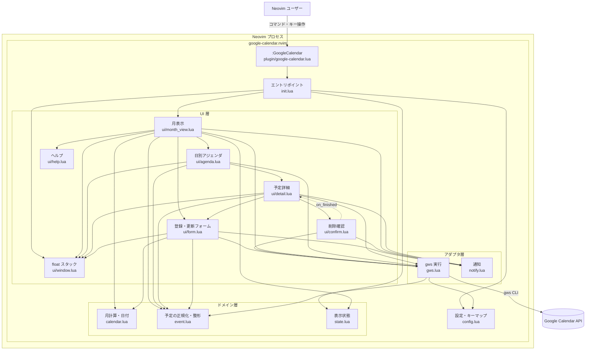

<!-- product-mode: cli -->
# google-calendar.nvim 設計書

- 種別: 設計書
- 対象: google-calendar.nvim
- 作成日: 2026-10-27
- 前提: [USER_STORIES.md](USER_STORIES.md) / [USECASES.md](USECASES.md) / [FEASIBILITY.md](FEASIBILITY.md)

## 目的とスコープ

**目的**: Neovim を離れずに Google カレンダーの月表示を開き、予定の確認・登録・更新・削除・Google Meet URL の付与を行えるようにする。予定の操作は `gws` コマンドを必須とし、認証と Google Calendar API の呼び出しは `gws` に任せる。

**スコープに含むもの**:

- `:GoogleCalendar` で当月の月表示 float window を開く。`YYYY-MM` を指定するとその月で開く
- 前月・次月・今日への表示切り替え（月単位の切り替え）
- 日付セルごとの予定表示（既定 7 件、設定可能、超過は `+N`）、日別アジェンダ、予定詳細
- 予定の登録・更新・削除（削除は確認付き）
- 登録時の Google Meet URL の付与（`gws calendar +insert --meet`）
- 終日予定の表示・登録・更新
- Meet URL のクリップボードへのコピー
- gws の未インストール・未認証・API エラーの判別と通知
- キー操作のヘルプ

**スコープに含まないもの（非ゴール）**: [USER_STORIES.md](USER_STORIES.md) の Won't と 1 対 1 で対応させる。

| 非ゴール | 理由 |
| --- | --- |
| カレンダーごとの表示/非表示の切り替え | 設定した全カレンダーを統合表示する |
| 予定のキーワード絞り込み | 月表示の一覧性を優先する |
| 週表示・日表示 | MVP は月表示のみ |
| 招待メールの文面カスタマイズ | gws の既定の招待に任せる |
| 繰り返し予定のルール編集 | RRULE の入力 UI と例外日の扱いが複雑。表示は `singleEvents=true` で各 occurrence を扱う |
| 予定ごとの色変更 | カレンダー色の利用で足りる |
| 複数 Google アカウントの切り替え | gws の認証は 1 アカウント前提 |
| 通知・リマインダー、ステータスライン表示 | プラグインの責務を月表示に絞る |
| オフラインキャッシュ | gws 必須の方針と矛盾する |
| Google カレンダー自体の作成・削除・共有設定 | Google カレンダー UI の領域 |

## アーキテクチャと技術選定

**ランタイム**: Neovim 0.10 以上（`vim.system` / `nvim_open_win` / extmark を使う）。Lua のみで実装し、実行時の外部 Lua 依存は持たない（nui.nvim 等は使わない）。`gws` を外部コマンドとして必須とする。

**技術選定の根拠**（[FEASIBILITY.md](FEASIBILITY.md) の PoC 結果）:

- `gws-calendar-crud` (verified): `gws` の list / `+insert --meet` / patch / delete / 終日 insert が動作する。更新は `events update`（PUT）を使う。`events patch` は終日⇔時刻付きの切り替えで `Invalid start time.` になるため使わない。削除は `cwd` を一時ディレクトリにして `download.html` の副作用を避ける
- `nvim-month-grid` (verified): `nvim_open_win` + `virt_lines` + extmark で 7 列×6 週のグリッドと日本語セルを描画できる。float を閉じるときは親へ明示的にフォーカスを戻す
- `headless-e2e` (verified): headless Neovim で `nvim_feedkeys` と `vim.wait` による E2E が書ける
- `timezone-conversion` (verified): RFC3339 のオフセットを考慮したローカル時刻変換ができる
- `gws-pagination` (verified): `nextPageToken` によるページ追加取得ができる
- `gws-sandbox-config` (verified): 開発環境では `GOOGLE_WORKSPACE_CLI_CONFIG_DIR` で実 API を検証できる

**全体構成図**（実線は `require` による依存、破線はコールバック）:



**主要コンポーネントと責務**:

| モジュール | 責務 |
| --- | --- |
| `plugin/google-calendar.lua` | `:GoogleCalendar` の登録と引数の補完 |
| `lua/google-calendar/init.lua` | `setup()`、コマンド実行、月表示の起動、再表示 |
| `lua/google-calendar/config.lua` | 既定値、キーマップ、ハイライト、入力検証 |
| `lua/google-calendar/calendar.lua` | 月グリッドの計算、日付の加算、RFC3339 変換、表示用フォーマット |
| `lua/google-calendar/event.lua` | gws の JSON を予定モデルへ正規化、時刻・終日・Meet URL の整形、表示幅での切り詰め |
| `lua/google-calendar/state.lua` | 表示中の年月、選択日、予定キャッシュ、月キャッシュ、読み込み中フラグ、float スタック |
| `lua/google-calendar/gws.lua` | `vim.system` による gws 実行、一覧のページ取得、作成・取得・更新・削除、エラー分類 |
| `lua/google-calendar/notify.lua` | エラー種別ごとの通知文言と `vim.notify` |
| `lua/google-calendar/ui/window.lua` | float の生成・破棄・フォーカス復帰、共通のバッファ設定 |
| `lua/google-calendar/ui/month_view.lua` | 月グリッドの描画、日選択、キーマップ、月移動、再取得 |
| `lua/google-calendar/ui/agenda.lua` | 選択日の予定一覧、予定選択 |
| `lua/google-calendar/ui/detail.lua` | 予定詳細の表示、編集・削除・Meet URL コピーへの導線 |
| `lua/google-calendar/ui/form.lua` | 登録・更新フォームの描画、入力検証、保存 |
| `lua/google-calendar/ui/help.lua` | 画面ごとのキー一覧 |
| `lua/google-calendar/ui/confirm.lua` | 削除確認（`y` / `n`） |

**依存の向き**: `init` → `config` / `notify` / `state` / `ui` / `gws`。`ui` → `calendar` / `event` / `gws` / `notify` / `state` / `window`。`gws` → `config` / `event`（通知は `config.get().notify` 経由）。`notify` → `config` / `event`。`confirm` は `month_view` を require せず、`detail` が渡す `on_finished` コールバックで詳細を閉じて再取得する。循環依存を作らない。

**状態管理**:

```lua
state = {
  year = 2026,
  month = 10,
  selected_date = '2026-10-27',
  events_by_date = { ['2026-10-27'] = { event, ... } },
  loading = false,
  windows = { month = winid, agenda = winid, detail = winid, form = winid, help = winid, confirm = winid },
}
```

**非同期実行**: `gws` の呼び出しはすべて `vim.system` のコールバックで行い、UI をブロックしない。1 つの画面につき同時に 1 つのリクエストだけを実行し、実行中は `loading = true` として `読み込み中...` を表示するが、移動・再取得・opener・close は受け付ける。完了後に `loading = false` とし、成功なら再描画、失敗なら通知する。

## 開発・検証コマンド

**計測日**: 2026-10-27。開発環境は macOS、Neovim 0.13.0-nightly+ac9ddec、stylua 2.6.0、luacheck 1.2.0、lua-language-server 3.19.2、Python 3.14.6。

**前提**:

- Neovim 0.10 以上（計測環境は 0.13 nightly）
- `gws` 0.22.5 以上（実 API の手動確認時のみ。自動テストは偽 gws を使う）
- `plenary.nvim`（テスト実行時のみ。`PLENARY_PATH` で場所を指定できる。既定は `~/.local/share/nvim/lazy/plenary.nvim`）
- `stylua` 2.x / `luacheck` 1.x / `lua-language-server` 3.x（lint・format・型チェック）
- Python 3（偽 gws の実行）

**セットアップ**:

```bash
git clone git@github.com:skanehira/google-calendar.nvim.git
cd google-calendar.nvim
# plenary.nvim が無い場合
git clone --depth 1 https://github.com/nvim-lua/plenary.nvim \
  ~/.local/share/nvim/lazy/plenary.nvim
```

**テスト**:

```bash
make test          # lua/ 配下の *_spec.lua を plenary の busted harness で実行
make test-file FILE=lua/google-calendar/config_spec.lua
make test-e2e      # 偽 gws を使った headless E2E
```

`make test` は `scripts/test.sh` が次を実行し、出力の `Success` / `Failed` / `Errors` を集計する:

```bash
nvim --headless -u tests/minimal_init.lua \
  -c "PlenaryBustedDirectory lua/ {minimal_init = 'tests/minimal_init.lua', sequential = true}"
```

実測値:

- `make test`: 277 tests passed / 0 failed / 0 errors、exit 0
- `make test-file FILE=lua/google-calendar/config_spec.lua`: 17 tests passed、exit 0
- `make test-file FILE=lua/google-calendar/gws_spec.lua`: 17 tests passed、exit 0
- `XDG_STATE_HOME="$PWD/.tmp-state" make test`: 277 tests passed、exit 0
- `make test TEST_DIR=<空ディレクトリ>`: exit 2、`spec が 0 件です` を出力（0 件のまま成功しない）

`TEST_DIR` は既定 `lua/`。spec は実装ファイルの隣 (`lua/**/*_spec.lua`) に置く。テストハーネスの spec も `lua/google-calendar/test_harness_spec.lua` に置き、`make test` の走査対象に含める。E2E の spec は `tests/e2e/` に置き、`make test-e2e` で実行する。

`tests/minimal_init.lua` は plenary とリポジトリ自身を `runtimepath` に追加し、`plugin/plenary.vim` を明示的に読み込む。`PlenaryBustedDirectory` が未定義なら `cquit 1` で終了する。`PlenaryBustedDirectory` は spec が 0 件のディレクトリで終了コード 0 を返すため、minimal_init 側で 0 件なら `cquit 1` にして 0 件のまま成功するのを防ぐ。サンドボックス環境では `XDG_STATE_HOME` をワークスペース内の書き込み可能なディレクトリに向ける（`nvim.log` の書き込みエラーを避ける。Makefile の既定は `.tmp-state/`）。

**静的チェック**:

```bash
make lint          # luacheck lua/ plugin/ tests/
make format        # stylua lua/ plugin/ tests/
make format-check  # stylua --check lua/ plugin/ tests/
make typecheck     # scripts/typecheck.sh (lua-language-server --check . --configpath=.luarc.json)
make check         # lint + format-check + typecheck + test
```

実測値:

- `make lint`: 0 warnings / 0 errors in 14 files、exit 0
- `make format-check`: exit 0
- `make typecheck`: exit 0。陽性対照として未定義グローバルを 1 つ置くと `1 problems found` で exit 1（make 経由では exit 2）
- `make check`: exit 0

`lua-language-server --check` は診断があっても exit 0 を返すため、`scripts/typecheck.sh` は `--check_format=json` の出力を検査し、問題があれば exit 1 にする。`.luarc.json` は `--check` に渡したパスをワークスペースルートとして探すため、リポジトリルートで `--check . --configpath=.luarc.json` を実行する（`--check lua/` では `.luarc.json` が読まれない）。

CI では `leafo/gh-actions-luarocks` がリポジトリ直下に `.luarocks/` を作るため、`.luarc.json` の `workspace.ignoreDir` で `.luarocks` / `.git` / `.tmp-state` / `.claude` / `.local` / `.poc` を除外する（除外しないと `--check .` が依存パッケージを検査して CI が落ちる）。

**E2E**:

```bash
make test-e2e
```

`scripts/e2e.sh` は `tests/fixtures/fake-gws.py` への `gws` シンボリックリンクを一時 `PATH` の先頭に置き、`FAKE_GWS_STATE` / `XDG_STATE_HOME` / `FAKE_GWS_CWD_LOG` / `FAKE_GWS_CALL_LOG` を一時ディレクトリに設定して `tests/e2e` を plenary で実行する。実カレンダーは変更しない。

実測値: `make test-e2e` は 12 tests passed / 0 failed / 0 errors、exit 0。スモークテストは偽 gws が PATH の先頭にあること、空の `events list`、`+insert` 後の `list` への反映、`:GoogleCalendar` の登録、`setup()` の既定値を確認する。`tests/e2e/crud_spec.lua` は偽 gws を使い、月表示を開いて登録・更新・削除を通しで検証し、`+N`、認証エラー、作成失敗、`:w` 連打、各操作後の状態ファイルとバッファ内容の一致を確認する。

**実 API の手動確認**（任意）:

```bash
# DSH などの workspace-write 環境では、gws の設定ディレクトリをワークスペース内へ向ける
mkdir -p .local/gws-config
cp ~/.config/gws/client_secret.json ~/.config/gws/credentials.enc .local/gws-config/
GOOGLE_WORKSPACE_CLI_CONFIG_DIR="$PWD/.local/gws-config" gws calendar calendarList list --params '{"maxResults":5}'
```

`.local/` は `.gitignore` に入れる。本番利用では既定の `~/.config/gws` のままでよい。

**worktree セットアップ**: 依存は plenary のみで、`PLENARY_PATH` を環境変数で指定できるため、worktree ごとに追加のセットアップは不要。`PLENARY_PATH` の既定は `~/.local/share/nvim/lazy/plenary.nvim`、`XDG_STATE_HOME` の既定は `<repo>/.tmp-state`（Makefile が作成する）。E2E は一時ディレクトリを使い、固定ポートを共有しない。`.gitignore` に `.claude/worktrees/`、`.local/`、`.poc/`、`download.html`、`*.log`、`__pycache__/`、`.tmp-state/` を入れる（worktree 並列実行と clean チェックの前提）。

**CI**: `.github/workflows/ci.yml` が `make check` を実行する。plenary.nvim を clone して `PLENARY_PATH` の既定パスに置き、luacheck / stylua / lua-language-server を導入する。CI の実行結果は未計測（この issue ではローカルで `make check` の green を確認）。

## CLI インターフェース

**コマンド**:

| コマンド | 引数 | 動作 |
| --- | --- | --- |
| `:GoogleCalendar` | なし | 当月の月表示を開く。既に開いている場合はメモリキャッシュを使ってフォーカスする（再取得は `r` / `R`） |
| `:GoogleCalendar <YYYY-MM>` | `2026-11` 形式 | 指定した月の月表示を開く |
| `:GoogleCalendar <YYYY-MM>` | 不正な形式 | `Month must be specified in YYYY-MM format` と通知し、開かない |

`nargs = '?'`、`complete` は `YYYY-MM` の候補を返す。コマンドは `plugin/google-calendar.lua` で登録する。

**キーマップ（既定）**:

| 画面 | キー | 動作 |
| --- | --- | --- |
| 月表示 | `h` / `l` | 前日 / 翌日を選択 |
| 月表示 | `k` / `j` | 前週 / 翌週を選択 |
| 月表示 | `H` / `L` | 前月 / 次月へ移動 |
| 月表示 | `t` | 今日へ移動 |
| 月表示 | `<CR>` | 選択日の日別アジェンダを開く |
| 月表示 | `a` | 選択日の予定を登録する |
| 月表示 | `r` / `R` | 表示中の月を再取得する（キャッシュを破棄する） |
| 月表示 | `?` | ヘルプを開く |
| 月表示 | `q` / `<Esc>` | 月表示を閉じる |
| アジェンダ | `j` / `k` | 予定を選択 |
| アジェンダ | `<CR>` | 予定詳細を開く |
| アジェンダ | `d` | 選択中の予定を削除する |
| アジェンダ | `q` / `<Esc>` | 月表示に戻る |
| 詳細 | `e` | 更新フォームを開く |
| 詳細 | `d` | 削除確認を開く |
| 詳細 | `y` | Meet URL をコピーする |
| 詳細 | `g` | ゲスト一覧を折り畳み・展開する |
| 詳細 | `q` / `<Esc>` | アジェンダに戻る |
| 確認 | `y` | 予定を削除する |
| 確認 | `n` / `q` / `<Esc>` | 確認を閉じる（削除しない） |
| フォーム | `<Tab>` / `<S-Tab>` | 次の行 / 前の行へ移動する |
| フォーム | `<CR>` | 選択行のエディタを開く。Meet 行ではトグル |
| フォーム | `<Space>` | 終日・Meet のトグルを切り替える |
| フォーム | `:w` | 保存する（`<C-s>` は herdr の prefix と衝突するため使わない） |
| フォーム | `<Esc>` / `q` | キャンセルする（入力は破棄）。`<Esc>` は insert モードでは insert を抜けるだけで、normal モードでキャンセルする。`q` は normal モードのみ |
| フォーム | `?` | フォームのヘルプを開く |
| フォームエディタ | `<CR>` | 日時フィールドの編集を開始する |
| フォームエディタ | `:w` | エディタの値を適用して閉じる |
| フォームエディタ | `<Esc>` / `q` | 適用せずにエディタを閉じる |
| ヘルプ | `q` / `<Esc>` | ヘルプを閉じる |

キーマップは `setup({ keymaps = { ... } })` で画面ごとに上書きできる。`false` を指定するとそのキーを無効にする。すべての画面のキーは `config.keymaps.<screen>.<action>` から解決し、実装に直書きしない。ヘルプを閉じる `q` / `<Esc>` は `help.close` / `help.esc_close`、アジェンダ・詳細を閉じる `q` / `<Esc>` は `agenda.esc_close` / `detail.esc_close`、月表示を閉じる `q` / `<Esc>` は `month.close` / `month.esc_close` で別々に変更・無効化できる。フォームの `<Esc>` / `q` も `form.cancel` / `form.close` で別々に変更・無効化できる（`q` は normal モードのみ。`form.cancel` は insert モードでは insert を抜けるだけ、normal モードでキャンセルする）。保存の既定コマンドは `:w`（`<C-s>` は herdr の prefix と衝突するため使わない）。

**設定（`setup()`）**:

```lua
require('google-calendar').setup({
  -- 追加で表示するカレンダー。primary は常に先頭に含まれ、外せない
  -- 通常は設定ファイルに書く（dotfiles に個人情報を置かない）
  calendars = { 'work@example.com' },
  -- 週の開始曜日。'sunday' または 'monday'
  week_start = 'sunday',
  -- 1 セルに表示する予定の最大件数（1〜10、既定 7）
  max_events_per_cell = 7,
  -- float のサイズ（ボーダーを除く利用可能領域に対する割合。1.0 で画面いっぱい）
  width = 1.0,
  height = 1.0,
  -- アジェンダ / 詳細のサイズ（同じく利用可能領域に対する割合）
  agenda = { width = 0.5, height = 0.7 },
  detail = { width = 0.5, height = 0.5 },
  -- 日時の表示形式
  date_format = '%Y-%m-%d %H:%M',
  -- gws の実行ファイル（テストでは偽 gws を指定）
  gws_cmd = 'gws',
  -- 通知関数（テストで差し替え可能）
  notify = vim.notify,
  -- クリップボードへの書き込み関数（テストで差し替え可能）
  clipboard = function(url)
    vim.fn.setreg('+', url)
  end,
  -- キーマップの上書き（画面ごとに指定。false で無効化）
  keymaps = {
    month = {
      prev_day = 'h', next_day = 'l', prev_week = 'k', next_week = 'j',
      prev_month = 'H', next_month = 'L', today = 't',
      agenda = '<CR>', create = 'a', refresh = 'r', help = '?', close = 'q', esc_close = '<Esc>',
    },
    agenda = { next = 'j', prev = 'k', open = '<CR>', help = '?', close = 'q', esc_close = '<Esc>' },
    detail = {
      edit = 'e',
      delete = 'd',
      copy_meet = 'y',
      toggle_guests = 'g',
      help = '?',
      close = 'q',
      esc_close = '<Esc>',
    },
    form = {
      next_field = '<Tab>', prev_field = '<S-Tab>', edit = '<CR>',
      toggle = '<Space>', save = ':w', cancel = '<Esc>', close = 'q', help = '?',
    },
    confirm = { yes = 'y', no = 'n', close = 'q', esc_close = '<Esc>' },
    help = { close = 'q', esc_close = '<Esc>' },
  },
  -- ハイライトの上書き
  highlights = {},
})
```

**カレンダー設定ファイル**:

カレンダー ID を dotfiles に書かないため、次のファイルから読み込む。

```text
stdpath('data')/google-calendar.nvim/config.json
```

```json
{
  "calendars": [
    "work@example.com"
  ]
}
```

- `primary` は常に表示され、外せない。自動的に先頭へ含めるため `calendars` に書く必要はない
- ファイルがなければ `primary` のみを使う。`calendars` が空配列でも `primary` のみになる
- 不正な JSON や不正な `calendars` の場合は警告し、`primary` にフォールバックする
- `GOOGLE_CALENDAR_CONFIG` で別のパスを指定できる
- `setup({ config_file = '/path/to/config.json' })` でもパスを上書きできる
- `setup({ calendars = { ... } })` を明示した場合はファイルより優先する

**環境変数**:

| 変数 | 用途 |
| --- | --- |
| `GOOGLE_WORKSPACE_CLI_CONFIG_DIR` | gws の設定ディレクトリ。サンドボックス環境での実 API 検証に使う |
| `PLENARY_PATH` | テスト時の plenary.nvim の場所 |
| `XDG_STATE_HOME` | サンドボックス環境で Neovim のログ出力先を書き込み可能にする |

**入出力と終了コード**:

- プラグインのコマンドは終了コードを持たない。エラーは `vim.notify` で通知する
- `gws` の終了コード: `0` 成功、`0` 以外は失敗。失敗時は stdout の JSON の `error.message` / `error.reason` を読む
- `gws` の stdout は JSON、stderr は `Using keyring backend: ...` などの診断行。stdout だけをパースする
- `gws calendar events delete` は cwd に `download.html` を生成するため、プラグインは `cwd` をキャッシュディレクトリ（`stdpath('cache')/google-calendar.nvim`）にする

## 横断規約

### エラー処理

- `gws` の失敗は次の 4 種に分類し、それぞれの通知文言を `notify.lua` に置く
  - **未インストール**: `vim.fn.executable(gws_cmd) == 0`、または `pcall(vim.system, ...)` の失敗（ENOENT）。README のセットアップ手順への案内を含める
  - **未認証**: 終了コード 2 かつ stdout の `error.reason == 'authError'`。`gws auth login` の実行を促す
  - **API エラー**: 上記以外の非 0。`error.message` を含める。404 は `The event has already been deleted.` として再取得する
  - **ネットワーク**: `vim.system` のタイムアウト / 接続失敗。再試行（`r`）を案内する
- 通知は `vim.notify(msg, vim.log.levels.ERROR)` を既定とし、成功時は `INFO` で 1 行だけ出す
- エラー時も Neovim をブロックしない（すべて非同期）

### 非同期とローディング

- `gws` 呼び出し中は `state.loading = true`。月表示のヘッダーに `読み込み中...` を表示するが、移動・再取得・アジェンダ/フォーム/ヘルプを開く・close は受け付ける。最後の要求 ID の応答だけを反映する
- フォームの保存中は `:w` を無効化し、フッターに `Saving...` を表示する
- 削除の確認中は `y` を無効化し、確認 float に `削除中...` を表示する
- 二重送信を防ぐため、同じ画面で同時に 1 リクエストだけを実行する

### 確認と取り消し

- 削除は専用の確認 float で `y` / `n` を取る。`q` / `<Esc>` でも閉じられる。`vim.fn.confirm` は使わない（headless テストの再現性のため）
- フォームのキャンセルは入力を破棄し、`gws` を呼ばない
- 更新フォームで変更がない場合は `gws` を呼ばずに閉じる

### 日時とタイムゾーン

- 予定の `dateTime` は RFC3339 としてパースし、イベントのオフセットを考慮してローカル時刻へ変換する。変換式は `epoch = os.time(components) + local_offset - event_offset`（PoC `timezone-conversion`）
- 終日予定は `start.date` / `end.date` をそのまま使い、時刻変換しない
- 月表示の取得範囲はローカルオフセット付きの RFC3339 で渡す。取得済みの月は `state.month_cache` に保持し、同じ月へ戻るときは再利用する。ウィンドウを閉じるか `r` / `R` で再取得すると破棄する
- 表示は `%H:%M`、詳細は `%Y-%m-%d %H:%M`

### 表示幅とテキスト

- 日本語を含む文字列は `vim.fn.strdisplaywidth` で幅を計算し、`vim.fn.strcharpart` で切り詰める。`#` や `string.sub` は使わない
- 予定タイトルの改行は空白に置換し、1 行に収める
- セル幅を超えるタイトルは末尾を `…` にする

### キーマップ

- すべての画面のキーは `config.keymaps.<screen>.<action>` から解決する。実装にキーを直書きしない
- `setup({ keymaps = ... })` は既定値と深くマージする。`false` を指定したキーは無効化する
- 未知の画面名・アクション名は `vim.notify` で警告し、無視する
- ヘルプは解決後のキーを表示する
- 保存の既定コマンドは `:w`。`<C-s>` は herdr の prefix と衝突するため使わない。ユーザーは `keymaps.form.save` で変更できる（例: `<A-s>`, `gs`）

### ハイライト

既定のハイライトグループ（`default = true` で定義し、ユーザーが上書きできる）:

| グループ | 用途 |
| --- | --- |
| `GoogleCalendarHeader` | 月タイトル・曜日ヘッダー |
| `GoogleCalendarToday` | 今日の日付 |
| `GoogleCalendarSelected` | 選択中の日付（オレンジ） |
| `GoogleCalendarSelectedBorder` | 選択中のセルの枠（オレンジ・bold の二重線） |
| `GoogleCalendarSunday` | 日曜の日付 |
| `GoogleCalendarSaturday` | 土曜の日付 |
| `GoogleCalendarOtherMonth` | 前月・翌月の日付 |
| `GoogleCalendarEvent` | 単日の時刻付き予定の文字（既定は属性なし） |
| `GoogleCalendarEventTime` | 予定の時刻 |
| `GoogleCalendarCalendarColor1`〜`GoogleCalendarCalendarColor11` | カレンダーごとの色付きドット（`primary` 先頭、続いて `calendars` の順に自動割り当て） |
| `GoogleCalendarCalendarBg1`〜`GoogleCalendarCalendarBg11` | カレンダーごとの予定バー背景（`primary` 先頭、続いて `calendars` の順に自動割り当て） |
| `GoogleCalendarDetailTitle` | 詳細のタイトル |
| `GoogleCalendarDetailIcon` | 詳細のセクションアイコン |
| `GoogleCalendarDetailMuted` | 詳細の補助情報 |
| `GoogleCalendarDetailMeet` | 詳細の Meet URL |
| `GoogleCalendarDetailAccepted` | 参加済みゲスト |
| `GoogleCalendarDetailPending` | 返答待ち・仮のゲスト |
| `GoogleCalendarDetailDeclined` | 辞退したゲスト |
| `GoogleCalendarFormTitle` | フォームのタイトル |
| `GoogleCalendarFormMuted` | フォームのプレースホルダー・補助情報 |
| `GoogleCalendarFormIcon` | フォームのセクションアイコン |
| `GoogleCalendarFormButton` | フォームの保存などのボタン |
| `GoogleCalendarFormSeparator` | フォームのタイトル下の区切り線 |
| `GoogleCalendarBorder` | float のボーダーと月表示の区切り線 |
| `GoogleCalendarError` | フォーム内のエラー |

`highlights` に `false` を指定するとそのグループを無効化する（既定の定義を消す）。

### float の管理

- float は 1 つのスタックで管理する。開くときはスタックに push し、閉じるときは pop して**親のウィンドウへ `nvim_set_current_win` で明示的に戻す**（Neovim は自動で戻さない。PoC `nvim-month-grid`）
- 月表示は 1 つだけ。既に開いている場合はメモリキャッシュを使ってフォーカスする。`r` / `R` で明示的に再取得する
- アジェンダ・詳細・フォーム・ヘルプ・確認は必要に応じて重ねる。`q` / `<Esc>` で 1 段ずつ閉じる

### UI の原則

- 月表示の縦線・横線は同じ `GoogleCalendarBorder` でハイライトする。
- `primary` と設定 `calendars` の追加カレンダーから予定を取得して統合し、月表示・アジェンダ・詳細に表示する。`primary` は常に先頭に含まれ外せない。新規作成は `primary`、更新・削除は予定の `calendar_id` を使う。
- 月表示は画面の利用可能領域に対する `width` / `height`（既定 1.0）でサイズを決める。各週は最低 `max_events_per_cell + 1` 行を確保し、余った高さを空の予定行に配分する。取得中と取得完了でサイズを変えない。アジェンダは `agenda` の `width` / `height`（既定 0.5 / 0.7）で縦長にし、詳細は `detail` の `width` / `height`（既定 0.5）でサイズを決める。フォーム・ヘルプ・確認は内容に合わせる
- 予定詳細は Google カレンダーの予定カード風に、アイコン付きのセクション（タイトル・日時・場所・ゲスト・説明・カレンダー）で表示する。ゲストの参加状況は `✓` / `○` / `?` / `✕` で示し、主催者には `主催者` を付ける。ゲストが 5 人を超える場合は折り畳んだ状態で開き、`g` で展開・折り畳みを切り替える
- 予定の登録・更新は Google カレンダーの作成ダイアログ風のメインウィンドウと、タイトル・日時・場所・説明・ゲスト用の個別エディタウィンドウを組み合わせて表示する。説明エディタはメインウィンドウと同じサイズで開く。アイコンは表示幅2文字に揃え、説明文を同じ列から開始する
- 日別アジェンダは予定ごとにカレンダー色の `●` / `○` ドット、開始時刻、タイトルを 1 行で表示する。場所は表示しない。仮・終日以外の空き予定は `○` にする
- 選択中の日付はセル全体の背景ではなく、オレンジ・bold の二重線フレーム（`GoogleCalendarSelectedBorder`）とオレンジの日付（`GoogleCalendarSelected`）で示す。予定バー・ドットはカレンダー色を保つ（今日の `GoogleCalendarToday` と重なっても選択が分かるようにする）。ウィンドウタイトルの `選択: MM-DD` でも示す
- 月表示の予定は Google カレンダー風に、終日・複数日予定はカレンダー色のバー（白文字）、単日の時刻付き予定はカレンダー色の `●` / `○` ドット＋開始時刻＋タイトルで表示する。複数日予定のバーは隣接する日セルと週行を跨いで連続し、セル境界の `│` を背景で覆う。バーのタイトルはバー全体の幅に合わせて切り詰める。色は `primary` を先頭に、続いて `calendars` の順で 11 色を自動割り当てし、12 件目以降は先頭に戻る
- 月グリッドは `│` の縦線に加えて、各週の上に `─` / `┼` の横線を引いてセルを区切る
- insert モードの `<Esc>` は insert を抜けるだけにし、normal モードでキャンセルする（Vim の慣習に合わせる）
- 画面を開いたら、実際のターミナルで代表データ（予定が多い日・長いタイトル・日本語）を使ってキー操作とスクリーンショットを確認する

### セキュリティ

- `gws` は `vim.system` に argv の配列で渡し、シェルを介さない。予定のタイトル・説明をコマンド文字列に埋め込まない
- JSON は `vim.json.encode` で生成する
- 予定の内容はバッファにテキストとして描画する（`vim.cmd` に渡さない）
- Meet URL のコピーは `vim.fn.setreg('+', url)` を使い、シェルを介さない

## ドメインモデル

| モデル | フィールド | 説明 |
| --- | --- | --- |
| Calendar | `id`, `summary`, `timeZone`, `backgroundColor` | `calendarList.list` の 1 件。MVP は primary のみ |
| Event | `id`, `summary`, `location`, `description`, `start`, `end`, `hangout_link`, `calendar_id`, `status` | 予定。`start` / `end` は `{ date = 'YYYY-MM-DD' }` または `{ dateTime = 'RFC3339', timeZone = '...' }` |
| DayCell | `date`, `day`, `in_month`, `weekday`, `events` | 月グリッドの 1 日。`events` は表示順に並べた予定 |
| MonthGrid | `year`, `month`, `weeks[6][7]` | 6 週×7 日のグリッド。週の開始は設定に従う |
| ViewState | `year`, `month`, `selected_date`, `events_by_date`, `loading`, `windows` | 表示状態 |

**不変条件**:

- `MonthGrid` は常に 6 週×7 日（42 セル）で、前月・翌月の日を含む
- `events_by_date` のキーは `YYYY-MM-DD`。時刻付き予定は開始日から終了日まで、終日予定は開始日から終了日の前日まで各日に載せる。複数日予定は月表示の行割り当てで隣接セルを跨ぐバーとして描画する
- `selected_date` は常に `MonthGrid` 内の日付

## インフラ

- **CI**: GitHub Actions で `make check` を実行する（luacheck / stylua --check / lua-language-server / plenary テスト）。plenary.nvim は CI で clone し、`PLENARY_PATH` を設定する
- **配布**: Neovim プラグインとして GitHub で公開する。Lua のみで、ビルド成果物は無い
- **リリース**: タグ付けのみ。パッケージマネージャ（lazy.nvim 等）はリポジトリを直接参照する
- **シークレット**: なし。認証情報は `gws` が管理する

## 既知の制約

- `gws` が必須。Google Calendar API を直接呼ぶフォールバックは持たない
- `gws calendar events delete` は cwd に `download.html` を生成する。`cwd` をキャッシュディレクトリにする（PoC `gws-calendar-crud`）
- `gws calendar events patch` は終日⇔時刻付きの切り替えで 400 `Invalid start time.` になる。更新は `events update`（PUT）を使い、`events get` で取得した編集可能フィールド（`summary` / `description` / `location` / `start` / `end` / `attendees` / `reminders` / `colorId` / `visibility` / `transparency` / `conferenceData`）を保持して送る。`conferenceData` を含める場合は `conferenceDataVersion=1` を付ける（PoC `gws-calendar-crud`）
- `gws` は stderr に `Using keyring backend: ...` を出す。stdout だけを JSON としてパースする
- `nextPageToken` が `null` のとき `vim.json.decode` は `vim.NIL` を返す。`vim.NIL` を終端として扱う（PoC `gws-pagination`）
- `events.list` の `maxResults` は最大 2500。超過分は `nextPageToken` で追加取得する
- 終日予定の `end.date` は排他日付。10 月 27 日の終日予定は `end.date = 2026-10-28` にする
- Neovim の float を閉じても、親の float へ自動でフォーカスは戻らない。`nvim_set_current_win` で明示的に戻す（PoC `nvim-month-grid`）
- `vim.system` は実行ファイル不在時に同期で `ENOENT` を raise する（コールバックの `err` では返らない）。呼び出し前に `vim.fn.executable(gws_cmd)` で確認し、`pcall` で包む
- `vim.system` の `timeout` はプロセスを TERM で終了し、コールバックの `code` は 124、`signal` は 15 になる。124 をタイムアウトとして `network` に分類する
- `vim.system` は Neovim 0.10 以上が必要
- 日本語の表示幅は `strdisplaywidth` / `strcharpart` で扱う。バイト長や `string.sub` では列がずれる
- `os.date('%z')` のローカルオフセットを使う変換式は、夏時間の境界では厳密でない。MVP は Asia/Tokyo を想定し、イベントのオフセットを優先する
- `os.date('%z')` は `+0900` 形式（コロンなし）を返す。RFC3339 のオフセットは `+09:00` 形式なので、変換時は両方を受け付ける
- サンドボックス環境では `gws` が `~/.config/gws` に書き込めない。開発時は `GOOGLE_WORKSPACE_CLI_CONFIG_DIR` をワークスペース内に向ける（PoC `gws-sandbox-config`）
- 月表示の予定は `singleEvents=true` で取得する。繰り返し予定のルール編集はできない
- `PlenaryBustedDirectory` は spec が 0 件のディレクトリで終了コード 0 を返す。`tests/minimal_init.lua` で 0 件なら `cquit 1` にして、テストが 0 件のまま成功しないようにする
- `PlenaryBustedDirectory` の子 Neovim は `--noplugin` で起動するため、`plugin/google-calendar.lua` のコマンドは spec 内で `runtime! plugin/google-calendar.lua` して明示的に読み込む。`nvim_create_user_command` に `force = true` を付けて再読み込みを安全にする
- `PLENARY_TEST_TIMEOUT` は Plenary が環境変数に文字列として設定するが、`plenary.test_harness._find_files_to_run` の `Job:sync` は数値を期待する。nested Neovim の実行前に `tests/minimal_init.lua` で一時的に unset する
- `lua-language-server` の `.luarc.json` は `--check` に渡したパスをワークスペースルートとして探す。`--check lua/` ではリポジトリルートの `.luarc.json` が読まれないため、`--check . --configpath=.luarc.json` を実行する
- `lua-language-server --check` は診断があっても exit 0 を返す。`scripts/typecheck.sh` が JSON 出力を検査して非 0 で終了する
- サンドボックス環境では `XDG_STATE_HOME` をワークスペース内の書き込み可能なディレクトリ（既定 `.tmp-state/`）に向ける。`nvim.log` の書き込みエラーを避ける
- `nvim_set_hl` の `default = true` は既存の定義を上書きしない。一度上書きしたハイライトグループを既定へ戻すには `default = false` で再定義する（`setup()` の複数回呼び出し）
- `vim.system` の `env` は Neovim 0.10 では `KEY=VALUE` のリスト、0.11 以降はマップで渡す。`clear_env = true` と併用するテストは `vim.fn.has('nvim-0.11')` で切り替える（0.10 でマップを渡すと環境変数が無視され、子プロセスの `PATH` が失われる）
- Linux の `execvp` は ENOEXEC のテキストファイルを `/bin/sh` で実行する。実行ファイルの起動失敗を再現するテストは、存在しないインタプリタを指す shebang を使う
- GNU make 4.x は `MAKEFLAGS` に `w` が入ると `make -n` の出力に `Entering directory` を混ぜる。レシピ順を検証するテストは `--no-print-directory` を付ける
- ヘッドレス環境では `+` レジスタへの書き込みが環境依存で失敗しうる。テストでは `config.clipboard` を注入して書き込みを検証し、`+` レジスタの内容を直接 assert しない。成功系は `vim.fn.has('clipboard')` を 1 に固定し、非対応環境のケースだけ 0 にモックする

## 未解決の論点

- 夏時間のあるタイムゾーンでの表示方針（MVP はイベントのオフセットを優先）
- キーマップの既定値の最終調整（`h/l` と `H/L` の割り当ては実装後に usability を確認）
