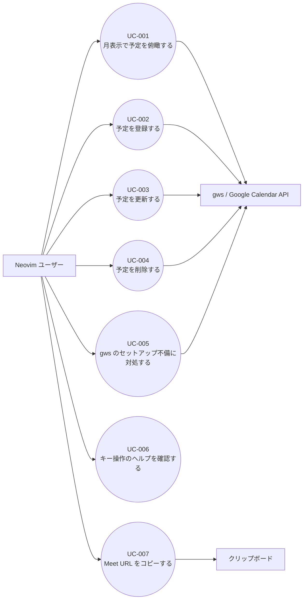

# ユースケース記述

- 種別: ユースケース記述
- 対象: google-calendar.nvim

各ユースケースの末尾に受け入れ基準を置く。受け入れ基準は「どんなときに、何をすると、どうなるか」を 1 文で書き、先頭にその基準が満たすストーリーの番号を付ける。チェックボックスは一覧の書式で、印は付けない。ユースケースの完了は、そのユースケースの親 issue の子 issue がすべて close したことで判定する。

## UC-001: 月表示で予定を俯瞰する

### 概要
| 項目 | 内容 |
|------|------|
| ユースケースID | UC-001 |
| ユースケース名 | 月表示で予定を俯瞰する |
| 主アクター | Neovim ユーザー |
| 副アクター | gws、Google Calendar API |
| トリガー | Neovim で `:GoogleCalendar` を実行する、または月表示を開いて予定を確認したいとき |

### 事前条件
- Neovim が起動している
- gws がインストールされ、認証済みである（未整備の場合は UC-005 のフローに分岐する）
- Google カレンダーにアクセスできる

### 事後条件
- 当月（または指定した月）の月表示 float window が開いている
- 表示範囲の予定が日付セルに並び、日別アジェンダと予定詳細を閲覧できる
- 月表示を閉じると元のウィンドウに戻る

### 正常系フロー
| # | アクター | アクション |
|---|----------|-----------|
| 1 | Neovim ユーザー | `:GoogleCalendar` を実行する |
| 2 | システム | gws の存在と認証状態を確認する |
| 3 | システム | 表示範囲（月初を含む週の日曜日から 6 週間）の予定を gws で取得する |
| 4 | システム | 月タイトル・曜日ヘッダー・6 週分の日付セルを持つ float window を開き、予定をセルに表示する |
| 5 | Neovim ユーザー | `h` / `l` / `j` / `k` で日を移動する |
| 6 | Neovim ユーザー | 日を選んで `<CR>` を押す |
| 7 | システム | その日の予定を開始時刻順に並べた日別アジェンダを開く |
| 8 | Neovim ユーザー | 予定を選んで `<CR>` を押す |
| 9 | システム | タイトル・開始/終了時刻・場所・説明・Meet URL を含む詳細を開く |
| 10 | Neovim ユーザー | `q` で詳細とアジェンダを閉じ、月表示に戻る |

### 代替フロー
#### A: 表示月を切り替える（ステップ5の代替）
| # | アクター | アクション |
|---|----------|-----------|
| 5a | Neovim ユーザー | `H` で前月、`L` で次月へ移動する |
| 5b | システム | 新しい月の予定を取得し、月タイトルとセルを更新する |

→ ステップ5に戻る

#### B: 今日へ戻る（ステップ5の代替）
| # | アクター | アクション |
|---|----------|-----------|
| 5a | Neovim ユーザー | `t` を押す |
| 5b | システム | 今日を含む月の表示に切り替え、今日のセルを強調する |

→ ステップ5に戻る

#### C: 年月を指定して開く（ステップ1の代替）
| # | アクター | アクション |
|---|----------|-----------|
| 1a | Neovim ユーザー | `:GoogleCalendar 2026-11` のように年月を指定して実行する |
| 1b | システム | 指定された月の月表示を開く |

→ ステップ2に戻る

#### D: セルに収まらない予定を確認する（ステップ6の代替）
| # | アクター | アクション |
|---|----------|-----------|
| 6a | Neovim ユーザー | `+N` が表示された日を選んで `<CR>` を押す |
| 6b | システム | その日の全予定を日別アジェンダに表示する |

→ ステップ8に戻る

### 例外フロー
#### E1: gws が見つからない（ステップ2）
| # | アクター | アクション |
|---|----------|-----------|
| 2a | システム | gws の実行ファイルが見つからないことを検知する |
| 2b | システム | gws の導入方法を含む通知を表示し、月表示を開かない |

#### E2: gws が未認証（ステップ2）
| # | アクター | アクション |
|---|----------|-----------|
| 2a | システム | gws が認証エラーを返す |
| 2b | システム | `gws auth login` の実行を促す通知を表示する |

#### E3: 予定取得に失敗する（ステップ3）
| # | アクター | アクション |
|---|----------|-----------|
| 3a | システム | gws がエラーを返す、または応答がない |
| 3b | システム | エラー内容を含む通知を表示し、再試行（`r`）を案内する |
| 3c | システム | 取得済みの表示がある場合はそれを維持する |

#### E4: 予定が 0 件（ステップ3）
| # | アクター | アクション |
|---|----------|-----------|
| 3a | システム | 予定が 0 件であることを検知する |
| 3b | システム | エラーにせず、予定行のない月表示を描画する |

### ビジネスルール
| ID | ルール |
|----|--------|
| BR-001 | 表示範囲は月初を含む週の開始曜日から 6 週間（42 日）とする。週の開始の既定値は日曜日 |
| BR-002 | 週の開始は既定で日曜日とし、設定 `week_start` で月曜に変更できる。曜日ヘッダーは週の開始に合わせて並べる |
| BR-003 | 1 つの日付セルに表示する予定は既定で最大 3 件とし、設定 `max_events_per_cell` で 1〜10 件に変更できる。超過分は `+N` で示し、全件は日別アジェンダで表示する |
| BR-004 | 予定の時刻はローカルタイムゾーンで表示する |
| BR-005 | 繰り返し予定は `singleEvents=true` で取得し、各 occurrence を通常の予定として表示する |
| BR-006 | 予定のタイトルはセルの表示幅に収まるよう切り詰め、末尾に `…` を付ける |
| BR-007 | 予定取得の `timeMin` / `timeMax` はローカルオフセット付きの RFC3339 で渡し、`timeMax` は表示範囲の翌日 0 時とする |
| BR-008 | 1 日の予定の並び順は終日予定を先頭にし、その後を開始時刻の昇順とする |
| BR-009 | 表示中の月の予定は `maxResults=2500` で取得し、`nextPageToken` がある限りページを追加取得する |

### 受け入れ基準
- [ ] （US-001）Neovim で `:GoogleCalendar` を実行すると、当月の月表示 float window が開き、月タイトルと曜日ヘッダーと 6 週分の日付セルが表示される
- [ ] （US-001）月表示を開いた状態で `q` を押すと float window が閉じ、元のウィンドウに戻る
- [ ] （US-002）月表示で `H` を押すと前月、`L` を押すと次月の表示に切り替わり、月タイトルと日付セルがその月のものになる
- [ ] （US-002）月表示で `t` を押すと今日を含む月の表示に戻り、今日のセルが強調される
- [ ] （US-002）`:GoogleCalendar 2026-11` のように年月を指定して実行すると、指定した月の表示で開く
- [ ] （US-003）予定がある日には、セルに開始時刻とタイトルが最大 3 件まで表示され、4 件以上ある日には `+N` が表示される
- [ ] （US-003）予定がない日には、セルに予定の行が表示されない
- [ ] （US-003）予定が 0 件の月を表示してもエラーにならず、全ての日に予定行が表示されない
- [ ] （US-004）日を選んで `<CR>` を押すと、その日の予定を開始時刻順に並べた日別アジェンダが開く
- [ ] （US-004）日別アジェンダで予定を選んで `<CR>` を押すと、タイトル・開始/終了時刻・場所・説明・Meet URL を含む詳細が開く
- [ ] （US-004）詳細で `q` を押すと日別アジェンダに戻り、さらに `q` を押すと月表示に戻る
- [ ] （US-001）gws が API エラーを返したときは、エラー内容を含む通知が出て、取得済みの表示がある場合はそれが維持される

## UC-002: 予定を登録する

### 概要
| 項目 | 内容 |
|------|------|
| ユースケースID | UC-002 |
| ユースケース名 | 予定を登録する |
| 主アクター | Neovim ユーザー |
| 副アクター | gws、Google Calendar API |
| トリガー | 月表示で予定を追加したい日を選び `a` を押す |

### 事前条件
- 月表示が開いている
- gws が認証済みである

### 事後条件
- 予定が Google カレンダーに作成されている
- 月表示が再取得され、作成した予定が該当セルに表示されている
- Meet を指定した場合は予定に Meet URL が付いている

### 正常系フロー
| # | アクター | アクション |
|---|----------|-----------|
| 1 | Neovim ユーザー | 日を選んで `a` を押す |
| 2 | システム | 選択した日付を開始日に設定した登録フォームを開く（開始 09:00、終了 10:00） |
| 3 | Neovim ユーザー | タイトル・開始日時・終了日時・場所・説明を入力する |
| 4 | Neovim ユーザー | 必要に応じて Meet を有効にする |
| 5 | Neovim ユーザー | `<C-s>` を押す |
| 6 | システム | 入力値を検証する |
| 7 | システム | gws で予定を作成する（Meet 有効時は会議 URL も作成する） |
| 8 | システム | フォームを閉じ、月表示を再取得し、作成した旨を通知する |

### 代替フロー
#### A: 終日予定として登録する（ステップ3の代替）
| # | アクター | アクション |
|---|----------|-----------|
| 3a | Neovim ユーザー | 終日を有効にする |
| 3b | システム | 時刻入力を無効化し、開始日と終了日（排他）の入力に切り替える |

→ ステップ5に戻る

#### B: 登録を中止する（ステップ5の代替）
| # | アクター | アクション |
|---|----------|-----------|
| 5a | Neovim ユーザー | `Esc` を押す |
| 5b | システム | フォームを閉じ、gws を呼ばない |

### 例外フロー
#### E1: 入力値が不正（ステップ6）
| # | アクター | アクション |
|---|----------|-----------|
| 6a | システム | タイトルが空、日時が不正、または終了が開始以前であることを検知する |
| 6b | システム | フォーム内にエラーを表示し、gws を呼ばない |

#### E2: 作成に失敗（ステップ7）
| # | アクター | アクション |
|---|----------|-----------|
| 7a | システム | gws がエラーを返す |
| 7b | システム | フォームを閉じずにエラーを表示し、入力値を保持する |

#### E3: Meet の作成に失敗（ステップ7）
| # | アクター | アクション |
|---|----------|-----------|
| 7a | システム | 予定は作成されたが Meet URL が付かなかったことを検知する |
| 7b | システム | 予定の作成自体は成功として扱い、Meet URL が付かなかった旨の警告を表示する |

#### E4: 保存中の二重実行（ステップ5）
| # | アクター | アクション |
|---|----------|-----------|
| 5a | システム | 保存中は `<C-s>` を受け付けず、進捗を表示する |
| 5b | システム | 完了後に結果を表示する |

### ビジネスルール
| ID | ルール |
|----|--------|
| BR-010 | タイトルは必須とし、1〜1024 文字まで入力できる |
| BR-011 | 開始日時は終了日時より前でなければならない |
| BR-012 | 日時は `YYYY-MM-DD HH:MM` 形式で入力し、ローカルオフセット付きの RFC3339 に変換して gws に渡す |
| BR-013 | 登録フォームの初期値は選択日の 09:00〜10:00 とする |
| BR-014 | Meet は登録時のみ指定でき、作成後は更新で変更しない |
| BR-015 | 終日予定の `end.date` は排他日付とする（例: 10 月 27 日の終日予定は `2026-10-28` を終了日にする） |
| BR-016 | 作成後は表示中の月の予定を再取得する |

### 受け入れ基準
- [ ] （US-005）月表示で日を選んで `a` を押すと、選択した日付を開始日に設定した登録フォームが開く
- [ ] （US-005）フォームにタイトルと日時を入力して `<C-s>` を押すと、gws 経由で予定が作成され、月表示の該当セルにその予定が表示される
- [ ] （US-005）タイトルを空のまま `<C-s>` を押すと、フォーム内にエラーが表示され、gws は呼ばれない
- [ ] （US-005）終了時刻が開始時刻以前のまま `<C-s>` を押すと、フォーム内にエラーが表示され、gws は呼ばれない
- [ ] （US-005）フォームで `Esc` を押すと、フォームが閉じ、予定は作成されない
- [ ] （US-005）gws が作成に失敗した場合、フォームは閉じず、入力値が保持されたままエラーが表示される
- [ ] （US-006）登録フォームで Meet を有効にして `<C-s>` を押すと、作成された予定に Meet URL が付き、詳細に表示される
- [ ] （US-006）Meet の作成に失敗した場合、予定自体は作成され、Meet URL が付かなかった旨の警告が表示される
- [ ] （US-011）登録フォームで終日を有効にして `<C-s>` を押すと、時刻なしの終日予定として作成され、月表示に `終日` と表示される

## UC-003: 予定を更新する

### 概要
| 項目 | 内容 |
|------|------|
| ユースケースID | UC-003 |
| ユースケース名 | 予定を更新する |
| 主アクター | Neovim ユーザー |
| 副アクター | gws、Google Calendar API |
| トリガー | 予定の詳細を開き `e` を押す |

### 事前条件
- 月表示と予定の詳細が開いている
- gws が認証済みである

### 事後条件
- 予定の変更が Google カレンダーに反映されている
- 月表示が再取得され、変更が該当セルに表示されている
- 既存の Meet URL は保持されている

### 正常系フロー
| # | アクター | アクション |
|---|----------|-----------|
| 1 | Neovim ユーザー | 予定の詳細で `e` を押す |
| 2 | システム | 現在の値が入力された更新フォームを開く |
| 3 | Neovim ユーザー | タイトル・日時・場所・説明を変更する |
| 4 | Neovim ユーザー | `<C-s>` を押す |
| 5 | システム | 入力値を検証し、`events get` で取得した予定の編集可能フィールドを保持して、変更分を `events update`（PUT）で送る |
| 6 | システム | フォームと詳細を閉じ、月表示を再取得し、更新した旨を通知する |

### 代替フロー
#### A: 更新を中止する（ステップ4の代替）
| # | アクター | アクション |
|---|----------|-----------|
| 4a | Neovim ユーザー | `Esc` を押す |
| 4b | システム | フォームを閉じ、gws を呼ばない |

#### B: 終日予定と時刻付き予定を切り替える（ステップ3の代替）
| # | アクター | アクション |
|---|----------|-----------|
| 3a | Neovim ユーザー | 終日の有効/無効を切り替える |
| 3b | システム | 開始・終了の表現を日付または日時に切り替える |

→ ステップ4に戻る

### 例外フロー
#### E1: 入力値が不正（ステップ5）
| # | アクター | アクション |
|---|----------|-----------|
| 5a | システム | タイトルが空、日時が不正、または終了が開始以前であることを検知する |
| 5b | システム | フォーム内にエラーを表示し、gws を呼ばない |

#### E2: 更新に失敗（ステップ5）
| # | アクター | アクション |
|---|----------|-----------|
| 5a | システム | gws がエラーを返す |
| 5b | システム | フォームを閉じずにエラーを表示し、入力値を保持する |

#### E3: 予定が既に削除されている（ステップ5）
| # | アクター | アクション |
|---|----------|-----------|
| 5a | システム | gws が 404 を返す |
| 5b | システム | 予定が存在しない旨を通知し、月表示を再取得する |

### ビジネスルール
| ID | ルール |
|----|--------|
| BR-017 | 更新は `events get` で取得した予定の編集可能フィールドを保持し、変更分を `events update`（PUT）で送る。`events patch` は終日⇔時刻付きの切り替えで失敗するため使わない |
| BR-018 | Meet URL は更新の対象外とし、既存の値を保持する |
| BR-019 | 更新後は表示中の月の予定を再取得する |
| BR-020 | 更新フォームの初期値は予定の現在値とし、終日予定は終日として表示する |

### 受け入れ基準
- [ ] （US-007）予定の詳細で `e` を押すと、現在の値が入力された更新フォームが開く
- [ ] （US-007）タイトルを変更して `<C-s>` を押すと、gws 経由で予定が更新され、月表示の該当セルに新しいタイトルが表示される
- [ ] （US-007）開始時刻を変更して `<C-s>` を押すと、予定の開始時刻が更新され、月表示の該当セルに反映される
- [ ] （US-007）`Esc` を押すと更新フォームが閉じ、予定は変更されない
- [ ] （US-007）他者によって削除済みの予定を更新しようとすると、404 のエラーが通知され、月表示が再取得される
- [ ] （US-007）更新に失敗した場合、フォームは閉じず、入力値が保持されたままエラーが表示される
- [ ] （US-011）終日予定を時刻付き予定に変更して `<C-s>` を押すと、時刻付き予定として更新される

## UC-004: 予定を削除する

### 概要
| 項目 | 内容 |
|------|------|
| ユースケースID | UC-004 |
| ユースケース名 | 予定を削除する |
| 主アクター | Neovim ユーザー |
| 副アクター | gws、Google Calendar API |
| トリガー | 予定の詳細を開き `d` を押す |

### 事前条件
- 月表示と予定の詳細が開いている
- gws が認証済みである

### 事後条件
- 予定が Google カレンダーから削除されている
- 月表示が再取得され、削除した予定が表示されていない

### 正常系フロー
| # | アクター | アクション |
|---|----------|-----------|
| 1 | Neovim ユーザー | 予定の詳細で `d` を押す |
| 2 | システム | 削除の確認を表示する |
| 3 | Neovim ユーザー | `y` を押す |
| 4 | システム | gws で予定を削除する |
| 5 | システム | 詳細を閉じ、月表示を再取得し、削除した旨を通知する |

### 代替フロー
#### A: 削除を中止する（ステップ3の代替）
| # | アクター | アクション |
|---|----------|-----------|
| 3a | Neovim ユーザー | `n` または `Esc` を押す |
| 3b | システム | 確認を閉じ、gws を呼ばない |

### 例外フロー
#### E1: 削除に失敗（ステップ4）
| # | アクター | アクション |
|---|----------|-----------|
| 4a | システム | gws がエラーを返す |
| 4b | システム | エラーを通知し、予定を月表示に残す |

#### E2: 予定が既に削除されている（ステップ4）
| # | アクター | アクション |
|---|----------|-----------|
| 4a | システム | gws が 404 を返す |
| 4b | システム | 予定が存在しない旨を通知し、月表示を再取得する |

### ビジネスルール
| ID | ルール |
|----|--------|
| BR-021 | 削除は確認を挟み、`y` を押した場合のみ実行する |
| BR-022 | 削除後は表示中の月の予定を再取得する |

### 受け入れ基準
- [ ] （US-008）予定の詳細で `d` を押すと、削除の確認が表示される
- [ ] （US-008）確認で `y` を押すと、gws 経由で予定が削除され、月表示からその予定が消える
- [ ] （US-008）確認で `n` または `Esc` を押すと、確認が閉じ、予定は削除されない
- [ ] （US-008）削除に失敗した場合、エラーが通知され、予定は月表示に残る

## UC-005: gws のセットアップ不備に対処する

### 概要
| 項目 | 内容 |
|------|------|
| ユースケースID | UC-005 |
| ユースケース名 | gws のセットアップ不備に対処する |
| 主アクター | Neovim ユーザー |
| 副アクター | gws |
| トリガー | 月表示を開こうとして gws の不在または認証エラーが発生する |

### 事前条件
- Neovim が起動している
- gws がインストールされていない、または認証が切れている

### 事後条件
- ユーザーが原因と対処を理解している
- Neovim の操作がブロックされていない

### 正常系フロー
| # | アクター | アクション |
|---|----------|-----------|
| 1 | Neovim ユーザー | `:GoogleCalendar` を実行する |
| 2 | システム | gws の実行ファイルと認証状態を確認する |
| 3 | システム | 不備の種類に応じた通知を表示する |
| 4 | Neovim ユーザー | 通知に従って gws を導入または `gws auth login` を実行する |
| 5 | Neovim ユーザー | 再度 `:GoogleCalendar` を実行する |

### 代替フロー
#### A: 認証エラーから再認証する（ステップ2の代替）
| # | アクター | アクション |
|---|----------|-----------|
| 2a | システム | gws が認証エラーを返す |
| 2b | システム | `gws auth login` の実行を促す通知を表示する |
| 2c | Neovim ユーザー | `gws auth login` を実行してから再度開く |

→ ステップ5に戻る

### 例外フロー
#### E1: ネットワークエラー（ステップ2）
| # | アクター | アクション |
|---|----------|-----------|
| 2a | システム | gws がタイムアウトまたは接続エラーを返す |
| 2b | システム | ネットワークエラーである旨と再試行の案内を表示する |

### ビジネスルール
| ID | ルール |
|----|--------|
| BR-023 | gws 不在時は導入方法（README のセットアップ手順）を含む通知を表示する |
| BR-024 | 認証エラー時は `gws auth login` の実行を促す |
| BR-025 | エラー処理は非同期で行い、Neovim の操作をブロックしない |

### 受け入れ基準
- [ ] （US-009）gws が PATH にない状態で `:GoogleCalendar` を実行すると、gws が見つからない旨と導入方法を含む通知が出る
- [ ] （US-009）gws の認証が切れている状態で `:GoogleCalendar` を実行すると、`gws auth login` を促す通知が出る
- [ ] （US-009）gws が API エラーを返したとき、エラー内容を含む通知が出て、Neovim の操作がブロックされない

## UC-006: キー操作のヘルプを確認する

### 概要
| 項目 | 内容 |
|------|------|
| ユースケースID | UC-006 |
| ユースケース名 | キー操作のヘルプを確認する |
| 主アクター | Neovim ユーザー |
| 副アクター | なし |
| トリガー | 月表示またはフォームで `?` を押す |

### 事前条件
- 月表示またはフォームが開いている

### 事後条件
- 現在の画面で使えるキーの一覧が表示されている
- ヘルプを閉じると元の画面に戻る

### 正常系フロー
| # | アクター | アクション |
|---|----------|-----------|
| 1 | Neovim ユーザー | 月表示で `?` を押す |
| 2 | システム | 月表示で使えるキーの一覧を開く |
| 3 | Neovim ユーザー | `q` を押す |
| 4 | システム | ヘルプを閉じ、月表示に戻る |

### 代替フロー
#### A: フォームのヘルプを開く（ステップ1の代替）
| # | アクター | アクション |
|---|----------|-----------|
| 1a | Neovim ユーザー | 登録または更新フォームで `?` を押す |
| 1b | システム | フォームで使えるキーの一覧を開く |

→ ステップ3に戻る

### 例外フロー
#### E1: ヘルプを開けない（ステップ2）
| # | アクター | アクション |
|---|----------|-----------|
| 2a | システム | 別の float window が開いていて重ねて表示できないことを検知する |
| 2b | システム | 既存の float window を閉じてからヘルプを開く |

### ビジネスルール
| ID | ルール |
|----|--------|
| BR-026 | ヘルプは月表示・日別アジェンダ・詳細・フォームのそれぞれで、その画面で有効なキーだけを表示する |
| BR-027 | ヘルプのキーは `setup()` で変更したキーマップを反映する |

### 受け入れ基準
- [ ] （US-010）月表示で `?` を押すと、月表示で使えるキーの一覧が開く
- [ ] （US-010）登録フォームで `?` を押すと、フォームで使えるキーの一覧が開く
- [ ] （US-010）ヘルプで `q` を押すと閉じ、元の画面に戻る

## UC-007: Meet URL をコピーする

### 概要
| 項目 | 内容 |
|------|------|
| ユースケースID | UC-007 |
| ユースケース名 | Meet URL をコピーする |
| 主アクター | Neovim ユーザー |
| 副アクター | クリップボード |
| トリガー | 予定の詳細で `y` を押す |

### 事前条件
- 予定の詳細が開いている

### 事後条件
- Meet URL がクリップボードにコピーされている
- コピーした旨が通知されている

### 正常系フロー
| # | アクター | アクション |
|---|----------|-----------|
| 1 | Neovim ユーザー | 予定の詳細で `y` を押す |
| 2 | システム | 予定の Meet URL を取得する |
| 3 | システム | クリップボードにコピーし、コピーした旨を通知する |

### 代替フロー
#### A: Meet URL がない（ステップ2の代替）
| # | アクター | アクション |
|---|----------|-----------|
| 2a | システム | 予定に Meet URL がないことを検知する |
| 2b | システム | コピーできない旨を通知する |

### 例外フロー
#### E1: クリップボードが使えない（ステップ3）
| # | アクター | アクション |
|---|----------|-----------|
| 3a | システム | クリップボードへの書き込みに失敗する |
| 3b | システム | 失敗した旨と URL を通知に表示する |

### ビジネスルール
| ID | ルール |
|----|--------|
| BR-028 | コピー先は `+` レジスタ（システムクリップボード）とする |
| BR-029 | Meet URL がない予定ではコピーを行わず、その旨を通知する |

### 受け入れ基準
- [ ] （US-012）Meet URL を持つ予定の詳細で `y` を押すと、URL がクリップボードにコピーされ、コピーした旨の通知が出る
- [ ] （US-012）Meet URL を持たない予定の詳細で `y` を押すと、コピーできない旨の通知が出る
- [ ] （US-012）クリップボードが利用できない環境で `y` を押すと、失敗した旨と URL を含む通知が出る

## ユースケース図

